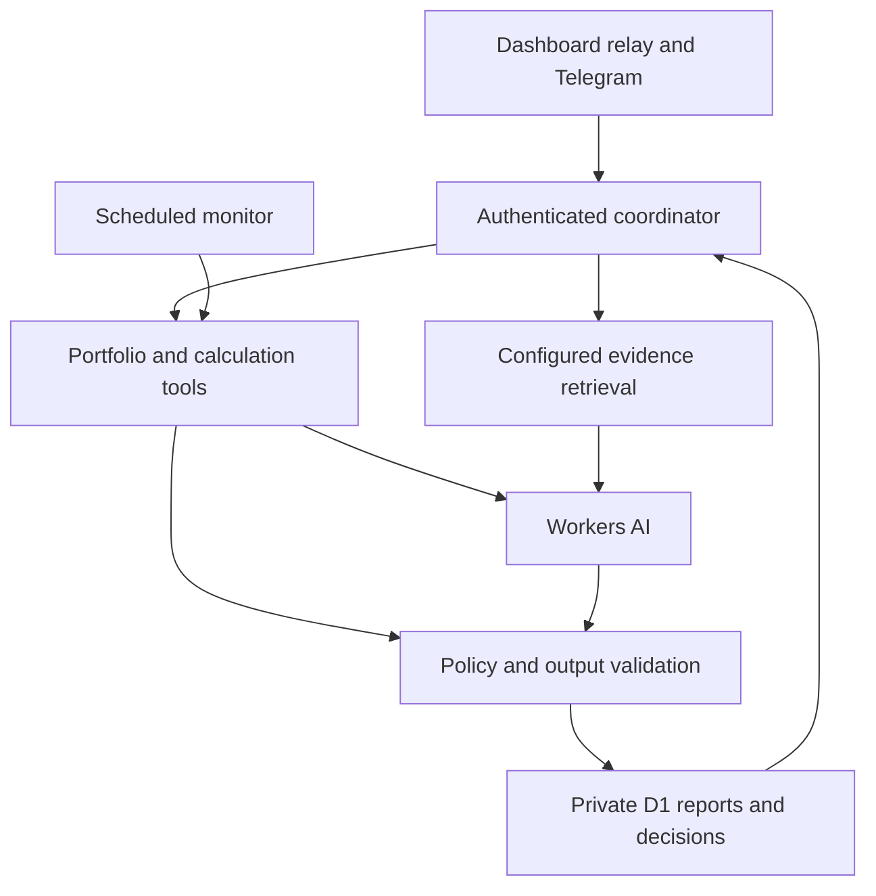

# Tiger Foundation Cloudflare AI Agent Implementation Plan

Source plan: https://chatgpt.com/space/page_23c29449edb481919a2ed0df766b7983

**Implementation handoff for Codex. Reviewed 5 November 2026.**

Build one **Portfolio Research and Strategy Agent** for [Tiger Foundation](https://tiger-foundation-dashboard.vercel.app/) using Cloudflare Workers AI on the free plan. It should explain verified portfolio data, research configured sources, compare strategies with deterministic calculations, monitor a confirmed risk policy, and maintain a decision journal.

The user reports that the Agent interface does not function. Source review found reusable backend scaffolding, but production bindings, secrets, migrations, inference and Telegram connectivity have not been verified. Treat activation as unproven until an end-to-end check succeeds.

The recommended sequence is **working foundation → reconciled data and calculations → cited research and strategy decisions → operational monitoring and paper evaluation**. Keep wallet access read-only. The owner makes investment and trading decisions.

**Repository reviewed:** [fung93/tiger-foundation-dashboard at 05fb5cf9a36d](https://github.com/fung93/tiger-foundation-dashboard/tree/05fb5cf9a36d58fa8fafa785b24b42478b69993e). Codex must inspect the current branch and its complete AGENTS.md before implementation; this snapshot is evidence for the plan, not permission to overwrite newer work.

# 1 Outcome and constraints

The finished agent should answer questions such as:

- “What changed in my portfolio, and which changes are market performance versus cash movements?”

- “What is the current risk in my avKAT/KAT borrowing position, and how much repayment would reach my chosen health target?”

- “Compare maintaining, widening or repositioning this LP range over my chosen horizon, including costs.”

- “What changed in the configured protocol announcements, incentives or governance sources, and which holdings could be affected?”

- “Why did I choose this strategy, what would invalidate it, and how has it performed since that decision?”

A useful answer must show its data time, coverage, calculation references, assumptions, source links and policy version. If a required input is unavailable, the affected conclusion must be unavailable too. Verified analysis of an unaffected market may still proceed.

## Requirements to preserve

Read [AGENTS.md](https://github.com/fung93/tiger-foundation-dashboard/blob/05fb5cf9a36d58fa8fafa785b24b42478b69993e/AGENTS.md) and [the existing setup guide](https://github.com/fung93/tiger-foundation-dashboard/blob/05fb5cf9a36d58fa8fafa785b24b42478b69993e/docs/AGENT-SETUP.md). In particular:

- Use free services. No OpenAI API dependency, paid model fallback, paid search dependency or automatic billing upgrade.

- Preserve existing dashboard design, navigation, themes and first-party authentication. Extend the current Vercel relay and Cloudflare Worker.

- Keep secrets server-side, agent conversations and settings private, and /api/agent routes outside service-worker caches.

- Keep financial access read-only: no private keys, wallet signing, swaps, repayments, voting or other transaction execution in this version.

- Preserve the Lending page's intentional per-visit reset: maximum LTV defaults of 70% / 35% / 35%. Store a persistent agent strategy policy separately.

- Preserve existing LP accounting rules, including staked Sushi fee routing and the exclusion of carry-over rewards from a replacement position's APR.

- Keep index.html and vercel/index.html identical when either changes; bump the service-worker cache version when required.

- Do not restore the removed Hedge Desk.

- Implement and validate locally. The repository requires explicit owner authorization for commits, pushes and deployment.

Success means a demonstrably working system with bounded costs and clear evidence. A visible chat box, configured model name or passing mocked test alone does not establish that.

# 2 What exists and what needs fixing

The [existing brain](https://github.com/fung93/tiger-foundation-dashboard/blob/05fb5cf9a36d58fa8fafa785b24b42478b69993e/api/_agent-brain.mjs), [context adapter](https://github.com/fung93/tiger-foundation-dashboard/blob/05fb5cf9a36d58fa8fafa785b24b42478b69993e/api/_agent-context.mjs), [service](https://github.com/fung93/tiger-foundation-dashboard/blob/05fb5cf9a36d58fa8fafa785b24b42478b69993e/api/_agent-service.mjs), [store](https://github.com/fung93/tiger-foundation-dashboard/blob/05fb5cf9a36d58fa8fafa785b24b42478b69993e/api/_agent-store.mjs) and [Worker](https://github.com/fung93/tiger-foundation-dashboard/blob/05fb5cf9a36d58fa8fafa785b24b42478b69993e/cloudflare/worker.mjs) provide a useful starting point.

| Area | Present in the reviewed source | Required work |
| --- | --- | --- |
| Model calls | Direct env.AI.run; up to two calls; 800 output tokens each; 25-second overall deadline | Replace the unavailable default; add tested model profiles, response normalization, schema validation and usage accounting |
| Context | Morpho, LP Book, data.json and history.json | Add a canonical current portfolio and bounded adapters for strategy, KAT trades, votes and research evidence |
| Financial tools | One verified lending calculation using shared targetMetrics | Add structured risk and scenario tools; preserve the shared arithmetic |
| Saved memory | Private D1 settings and the most recent 24 messages; four short messages reach the model | Add a durable policy, thesis and decision journal separate from chat history |
| Alerts | Deterministic monitoring, deduplication and daily summaries | Verify activation; extend conditions and prevent long research jobs from starving monitoring |
| Authentication | Vercel relay, private Worker gateway, sessions and Telegram webhook checks | Verify the real configuration and preserve the existing security boundaries |
| Cost controls | Five messages per minute; default 40 per day | Add atomic token and neuron budget reservations for every inference attempt |
| Research | No external research retrieval in the inspected agent modules | Add configured-source retrieval, evidence storage, citations and freshness checks |
| Strategy decisions | No complete LP scenario comparison or outcome journal | Build deterministic comparisons, validated decision briefs and later outcome evaluation |

## The first compatibility repair

Both [wrangler.jsonc](https://github.com/fung93/tiger-foundation-dashboard/blob/05fb5cf9a36d58fa8fafa785b24b42478b69993e/cloudflare/wrangler.jsonc) and the model fallback in the brain use **@cf/meta/llama-3.1-8b-instruct**. Cloudflare lists that model among those deprecated on **30 May 2026**, and its model page now redirects to an unavailable notice. Replace the exact retired identifier, its configuration and setup documentation. This is a verified compatibility issue; it is not proof that it is the only production failure. [Cloudflare deprecation notice](https://developers.cloudflare.com/changelog/post/2026-05-08-planned-model-deprecations/)

The current parser accepts a string or a string-valued response field. A replacement may return a choices array, structured content or tool calls. Changing only the model name is insufficient. The current provider-name regex also excludes zai-org while allowing broad families that may contain paid models; replace it with explicit, tested profiles.

A further gap: the context code preserves LP range fields initially, but the compact model payload drops some of them. Define one deliberate, versioned tool payload so the agent receives the range, price, valuation time and calculation results it needs.

# 3 What the free Cloudflare setup can support

| Capability | Feasible design |
| --- | --- |
| Explain holdings and risks | Fetch verified data and calculate facts in code; let the model explain them |
| Research protocols and investment theses | Retrieve a bounded set of configured public sources, cache evidence, then summarize with citations |
| Compare LP and lending choices | Run financial scenarios in shared code; have the model explain assumptions and tradeoffs |
| Maintain policy and decision history | Store versioned records in private D1 |
| Monitor risk and deliver alerts | Use the existing scheduled deterministic monitor; inference is unnecessary for threshold checks |
| Manage a strategy | Track thesis, invalidation conditions, review triggers and outcomes; prepare decisions for the owner |
| Broad continuous web research or large backtests | Exclude from the first release; these need additional data coverage, runtime capacity and validation |
| Execute trades | Outside this version's read-only scope |

## Model selection

Use **@cf/qwen/qwen3-30b-a3b-fp8** as the first candidate to evaluate. Its current model page documents function calling and a 32,768-token context window. **@cf/zai-org/glm-4.7-flash** is a second candidate if it performs better on the same fixtures; its documented context is 131,072 tokens. These are candidate configurations, not a benchmark result or a guarantee of access in the owner's account. Test actual free-account availability before adopting either. [Qwen model](https://developers.cloudflare.com/workers-ai/models/qwen3-30b-a3b-fp8/) · [GLM model](https://developers.cloudflare.com/workers-ai/models/glm-4.7-flash/)

Keep prompts much smaller than either context window. Prefer one model invocation over chained “researcher”, “critic” and “trader” model personas. One coordinator can expose several deterministic tools without paying for several independent model conversations.

Retain the direct Workers AI binding. A migration to Cloudflare's Agents SDK, a vector database or another agent framework is unnecessary for this scope.

## Inference budget

Cloudflare currently provides **10,000 neurons per account per day**, resetting at **00:00 UTC / 08:00 MYT**. Some models require billing even before this allowance is consumed, so the allowlist must be verified. Free-plan exhaustion should stop inference rather than trigger a paid fallback. [Workers AI pricing](https://developers.cloudflare.com/workers-ai/platform/pricing/)

Start with an application budget of **5,000 neurons per day** as a proposed configurable cap, leaving headroom for other use of the account. This is an application setting, not a Cloudflare entitlement.

For planning, the documented Qwen rates are 4,625 neurons per million input tokens and 30,475 per million output tokens. A call with 4,000 input and 1,000 billed output tokens therefore uses approximately **48.975 neurons**. Forty questions using two such calls each would use approximately **3,918 neurons**. This is an illustrative calculation; actual input, reasoning/output tokens, repairs, retries and other workloads must be measured. [Rates](https://developers.cloudflare.com/workers-ai/platform/pricing/)

Do not assume Workers AI includes free general web search. Cloudflare's documented web-search tool requires AI Gateway credits or a provider key. The free implementation should retrieve configured official pages, public APIs and feeds whose access terms and quotas permit it. Display the scope as “configured sources.” [Web-search setup and billing](https://developers.cloudflare.com/agents/tools/web-search/)

## Runtime limits

Workers Free currently allows 100,000 requests per day, 10 ms of CPU per HTTP or Cron invocation, 128 MB memory, 50 external subrequests and six simultaneous outgoing connections. Network waiting does not consume CPU, but parsing large payloads and running calculations does. Keep the Worker thin and profile real invocations. Reuse the existing dashboard data producers for heavy chain/history processing. [Workers limits](https://developers.cloudflare.com/workers/platform/limits/)

D1 Free currently includes five million rows read and 100,000 rows written daily, with 5 GB total storage and a 500 MB per-database limit. Use indexed, bounded queries and compact records. [D1 pricing](https://developers.cloudflare.com/d1/platform/pricing/) · [D1 limits](https://developers.cloudflare.com/d1/platform/limits/)

# 4 Architecture

Keep the existing deployment split:

| Component | Responsibility |
| --- | --- |
| Vercel dashboard and same-origin agent relay | Existing UI, session boundary and private relay to the Worker |
| Cloudflare Worker | Authenticated coordinator, tool authorization, model adapter, cost limits and response validation |
| Existing financial APIs and shared core modules | Current positions, prices, protocol arithmetic and compact normalized tool results |
| Private D1 | Policy versions, evidence, reports, job state, usage reservations and decisions |
| Existing Cron monitor | Deterministic risk checks, deduplication and daily factual summaries |
| Telegram integration | The same agent state and owner settings, through existing verified pairing and webhook controls |
| Optional bounded Cloudflare Workflow | Durable multi-step research that cannot fit the synchronous request budget |



The diagram shows logical responsibilities. Telegram and browser requests keep their separate existing authentication paths.

The coordinator chooses a bounded workflow: facts-only, risk calculation, research brief or strategy comparison. Retrieval and financial calculations happen before prose generation wherever possible. The model selects from a closed set of permitted tools and evidence references; it cannot choose arbitrary URLs, SQL, shell commands or transactions.

Use deterministic templates when inference is unavailable. This preserves factual answers and risk calculations while Workers and D1 remain available. A Workers, database or upstream data outage must instead be shown as degraded service.

# 5 Work package A Make the foundation work

**Existing files:** cloudflare/wrangler.jsonc, cloudflare/worker.mjs, api/_agent-brain.mjs, api/_agent-gateway.mjs, api/_agent-http.mjs, api/_agent-service.mjs, docs/AGENT-SETUP.md and existing agent tests.

**Proposed helpers:** api/_agent-models.mjs and api/_agent-budget.mjs. Adapt names to current conventions.

## A1 Diagnose activation

Trace browser login → same-origin relay → private Worker → D1 → Workers AI. Separate configuration readiness from successful live execution.

Add an authenticated diagnostic response through the existing agent handler. Report component status, configured model ID, schema version, last successful inference, last monitor success and sanitized error category. Do not expose secret values, tokens, conversation contents or raw provider errors.

Verify the AI and AGENT_DB bindings, D1 migrations, gateway secret agreement, session flow and endpoint configuration. The reviewed setup places AGENT_WORKER_URL and AGENT_GATEWAY_SECRET on Vercel; Worker secrets include AGENT_ACCESS_KEY, AGENT_GATEWAY_SECRET, Telegram credentials and CRON_SECRET. Preserve the documented distribution rather than moving secrets into the browser.

Use error categories such as configuration_missing, authentication_failed, model_unavailable, quota_exhausted, rate_limited, timeout, invalid_model_output, data_stale and data_unavailable.

## A2 Add model profiles and normalization

Each allowed model profile must specify the exact identifier, request format, output cap, response parser, schema/tool support and token-to-neuron rates with a verification date. Revalidate these before changing a production model.

Normalize provider responses into one internal object containing final content, allowed tool calls, finish reason and reported usage. Support only shapes verified for the selected profile. Reject truncated JSON, unknown tool names, malformed arguments and unsupported response formats.

Use the model's documented structured-output option when available, followed by server-side schema validation. Preserve the existing maximum of two inference calls per job initially; a repair consumes that budget. If validation still fails, return a deterministic partial result. Do not expose model reasoning traces as the answer.

Preserve independent validation of explicit user intent before preferences change. Do not broaden the current preference mutation boundary when adding tools.

## A3 Account for every attempt

Before each AI.run call, atomically reserve an estimated maximum cost in D1 using the model profile, full input estimate and output cap. Reject calls exceeding the remaining application budget. Settle with actual usage when available; otherwise retain a conservative estimate.

Count second passes, repairs, retries, scheduled research and Telegram requests against the same owner/account application ledger. The existing message counter remains a separate abuse control.

A Promise.race timeout does not prove that underlying inference was cancelled. Record timed-out attempts as outcome_unknown and conservatively retain their reservation until reconciliation. Do not immediately retry as though the first call were free.

Cache successful results by input, snapshot, evidence, model, schema and policy versions where appropriate. Never reuse a cached financial recommendation after its inputs expire.

**Acceptance:** a real short request can traverse the deployed architecture after deployment authorization; fixtures cover all configured response shapes; deprecated-model and quota failures are explained; invalid output cannot produce a financial action or policy update; concurrent requests cannot exceed the application budget.

# 6 Work package B Reconcile portfolio data before recommending allocation

**Inspect and extend:** api/_core.mjs, api/lpbook.mjs, api/morpho.mjs, api/_agent-context.mjs, relevant portfolio producers, index.html, vercel/index.html and portfolio tests. Add a shared canonical portfolio module only if current code lacks an appropriate home.

## B1 Reproduce the observed mismatch

During the earlier dashboard inspection on 5 November 2026, the live overview showed about 3.07K of LP value and zero Katana LP, while LP Book showed about 3,973.14 across two positions, including a Katana position around 899.97. The overview also displayed a sharp negative daily change.

These observations are a regression lead, not current balances or proof of a realized loss. Capture current endpoint responses and timestamps, trace asset movements and position discovery, and reproduce the discrepancy with fixtures. Investigate refresh timing, position filtering, stale caches, valuation sources and coverage before changing accounting. Never “fix” the total by adding a hardcoded 900.

## B2 Define one canonical snapshot

A snapshot must include:

- Stable snapshot ID and valuation basis.

- Per-chain block number and observation time; there is no single synchronized block across chains.

- Freshness and coverage for every required source.

- Position identity based on chain, protocol contract or market, position/NFT identifier and owner.

- Raw amounts as integer strings, token decimals, valuation prices and their provenance.

- Separate assets, liabilities, exposures, unpriced amounts and liquidity restrictions.

- Explicit status: complete, partial, stale or unreconciled, with machine-readable reasons.

Successful “no position” and failed “could not read position” are distinct results. A failed read cannot become a zero balance or inactive position.

Count each economic asset once. Receipt tokens and their represented underlying are alternate representations; LP look-through exposures are not extra assets. Account for debt once, including accrued interest. Claimed rewards already in a wallet cannot also remain claimable. Keep Tiger Vault's inclusion basis explicit and consistent with the existing product.

When allocation data is incomplete, show a subtotal and missing coverage. Do not present it as a complete NAV. Block portfolio-wide allocation sizing while allowing separately verified market calculations.

## B3 Repair performance semantics

Classify external deposits and withdrawals separately from internal transfers, LP openings, migrations, staking and lending movements. Reconcile live and historical coverage before showing daily P&L.

Do not rewrite history to disguise missing coverage. Mark coverage changes and periods that cannot support comparable returns. Compute time-weighted returns only when the cash-flow and valuation history supports them; otherwise show a clearly defined available measure or unavailable status.

Preserve staked Sushi accounting: use the position's actual reward routing; do not add generic swap fees to rewards when fees are routed elsewhere. Carry-over rewards can contribute to net wealth but must not inflate a replacement position's earned APR. Repeated capital across closed positions must not be summed as current wealth.

**Acceptance:** overview and LP Book reconcile at compatible observation times; a newly discovered LP does not create a false loss; receipt assets, debt and rewards are not duplicated; partial reads remain visible; historical coverage gaps are retained rather than fabricated.

# 7 Work package C Add a persistent strategy policy and verified tools

**Existing files:** api/_agent-service.mjs, api/_agent-store.mjs, api/_agent-context.mjs, morpho-core.mjs and the agent UI. **Proposed helpers:** api/_agent-policy.mjs and api/_agent-tools.mjs.

## C1 Separate policy from page controls

Create a versioned strategy policy with draft and confirmed states. Fields should include evaluation horizon, minimum liquid reserve, exposure limits, eligible assets/protocols, per-market target health or LTV limits, LP review triggers, allowed analysis types and review frequency. Unknown preferences remain unset.

The existing alert defaults are notification settings, not evidence of the owner's investment mandate. Display clearly which setting controls an alert. Do not silently convert an existing default into a confirmed strategy constraint.

The Lending page keeps its intentional reset on reload. The agent policy persists independently and is editable in the agent's settings. Every report records the policy version used.

Policy updates require a direct owner request and a preview of the changed fields before the new version becomes confirmed. This is a product interaction for future investment-policy changes, not a requirement to ask permission during implementation. Research text, quoted instructions or model output cannot update policy.

## C2 Use deterministic financial tools

Expose a closed registry of read and simulation functions. Suggested contracts:

| Tool | Output |
| --- | --- |
| getPortfolioSnapshot | Canonical holdings, exposure, debt, coverage and reconciliation |
| getLendingRisk | Current oracle-based LTV, health, accrued debt and sensitivity |
| calculateTargetHealth | Repay or collateral-change calculation using the existing shared core |
| getLPPosition | Range, current price, ownership/staking status, valuation and reward accounting |
| simulateLPOptions | Comparable, cost-aware outcomes under explicit price and reward assumptions |
| getKATExposure | Wallet, LP look-through, lending, locked exposure and debt without double counting |
| getProtocolEvidence | Retrieved passages and source IDs for configured sources |
| compareStrategies | Feasible options evaluated against a specific policy version |
| getDecisionHistory | Prior theses, decisions, invalidation rules and outcomes |

Version each tool schema. Validate market IDs, token units, maximum horizons, scenario counts and freshness before execution. The model cannot submit arbitrary code or formulas.

For lending, reuse targetMetrics and existing Morpho integer arithmetic. Preserve conservative rounding, interest accrual to the pinned block, the protocol's actual LLTV and per-market rules. Health at exactly 1 follows the repository's protocol semantics; don't invent a new liquidation definition.

Distinguish the avKAT/KAT collateral-to-debt oracle ratio from a KAT/USD market move. A percentage move to the liquidation boundary under fixed debt/collateral is a sensitivity calculation, not a forecast. Never label it as “KAT can fall by X%” unless that is actually the modeled variable.

Each numerical result carries a calculation ID, source snapshot, input units, assumptions, rounding policy and validity time. Render actionable amounts from this trusted object. The current English regex guard is insufficient as the main protection for multilingual or differently worded outputs.

**Acceptance:** policy persists across sessions while Lending page resets remain intact; calculations match the shared core; stale inputs prevent amount recommendations; common movements in collateral and debt USD prices do not incorrectly alter a fixed-ratio lending calculation.

# 8 Work package D Build bounded research with citations

**Existing files:** api/_agent-context.mjs and api/_agent-brain.mjs. **Proposed helper:** api/_agent-evidence.mjs.

## D1 Retrieve relevant portfolio context on demand

Inspect actual schemas before adding /api/strategy, /api/kat-trades and /api/vkat adapters. Fetch only the data required for the question. Keep a compact agent representation rather than passing entire histories into every prompt.

Include LP range and reward fields that the present compact context drops. Distinguish live reads from saved snapshots. A file's successful HTTP response is not evidence that its contents are current.

Reuse the existing data producers or add a compact view to an existing handler when necessary. Avoid duplicating heavy chain scans inside the free Worker or multiplying public Vercel function endpoints.

## D2 Configure a source registry

Start with the official documentation, announcement feeds, governance sources and public protocol APIs relevant to the held assets. Verify exact URLs and availability during implementation. Do not invent feed endpoints or pretend the allowlist covers the whole internet.

Each source record needs its URL, type, supported protocol/asset, expected update frequency, access method, byte limit, timeout and cache policy. Use conditional fetches where supported.

Retrieve at most four documents per ordinary research job initially, as an application cap. Bound text extraction and excerpt size; keep aggregate model context within the configured input budget. If extraction is too CPU-intensive for Workers Free, use a compact feed/API or the existing data-processing environment.

Allow only configured destinations and approved redirects. Block local/private-network targets, credential-bearing URLs and arbitrary model-selected fetches. Treat retrieved text as untrusted evidence, never as executable instructions or authority to change policy.

## D3 Store evidence and make uncertainty visible

Save a stable evidence ID, canonical URL, document title, publication time when actually available, retrieval time, content hash, selected passage and supported claim. Do not invent a publication time when only retrieval time is known.

Every externally sourced claim in the brief must reference evidence supplied to the model. Validate that referenced IDs exist and render their URLs server-side. Remove unsupported factual claims or mark the result incomplete.

A brief should distinguish current protocol facts, historical observations, user assumptions and the agent's interpretation. Show conflicting sources, stale evidence and coverage gaps. Rank source relevance and freshness; avoid a numerical “confidence” score that looks statistically calibrated without evidence.

The first release can answer focused research questions from this registry. General discovery search is a separate future capability requiring an explicitly selected provider and cost model.

**Acceptance:** citations resolve to retrieved evidence; missing or stale sources produce a visible limitation; malicious instructions in a retrieved page cannot change policy or invoke tools; unavailable retrieval cannot be disguised as current research.

# 9 Work package E Compare strategies with cost-aware scenarios

**Reuse and inspect:** strategy-core.mjs, morpho-core.mjs, kat-core.mjs, vkat-core.mjs and their API adapters. **Proposed helper:** api/_agent-scenarios.mjs.

The model explains scenarios. Shared code calculates balances, ranges, exposures, costs and outcomes.

## E1 Lending scenarios

Compare maintaining the position, reducing debt and adding collateral using fresh data and owner-supplied targets. Show resulting health, LTV, cash required and exposure. Evaluate interest-rate changes and the relevant oracle ratio, not just a generic USD price shock.

Use a scenario horizon and record how interest is projected. A stale or missing debt/rate input blocks any unsupported amount. A forecasted rate is an assumption, not a current fact.

## E2 LP scenarios

For an identified position, compare maintaining the current range, widening, repositioning and holding the underlying assets over the same horizon and capital base.

Include entry/repositioning gas, swap fees, estimated slippage, time out of range, reward eligibility, campaign/epoch duration, reward-token price assumptions, competing liquidity and any borrowing costs. Apply the position's actual staking and fee-routing rules.

Show several explicit price paths and incentive cases. Do not label invented scenario probabilities as expected returns. For each case, calculate terminal token amounts, terminal mark-to-market value, realized/eligible fees and rewards, transaction costs, and the difference from a hold benchmark. Avoid subtracting impermanent loss again if it is already reflected in the valuation comparison.

Keep historical realized results distinct from projected incentive income. A very short observed APR or a current campaign rate is not a reliable annual forecast. Do not annualize carry-over rewards as newly earned return.

## E3 KAT and portfolio choices

Calculate total economic KAT exposure across wallet tokens, LP look-through, lending collateral/debt and locked positions. Show locked capital and liquid capital separately.

Add a thesis record with catalysts, evidence, review date and invalidation conditions. Compare only feasible choices under the confirmed policy, capital availability and actual liquidity. An explicit “maintain and review” option should remain available.

Perpetual-futures hedging or a restored Hedge Desk is not part of this implementation. Supporting derivatives later would require separate funding, margin, liquidation, basis and venue models.

## E4 Avoid false backtest certainty

Use point-in-time inputs for historical replay. Include transaction costs, available liquidity, reward eligibility and campaign rules known at the time. Separate tuning periods from evaluation periods. Label inadequate history and small samples.

Existing closed positions can describe observed results; they do not establish a reliable future win rate. Begin prospective paper evaluation before treating an automated ranking as trustworthy.

**Acceptance:** comparable options use the same capital and horizon; every amount comes from a calculation object; costs and reward assumptions change results in the expected direction; missing inputs block the affected option; no unsupported probability or guaranteed profit appears.

# 10 Work package F Add durable decisions jobs and monitoring

**Existing files:** api/_agent-store.mjs, api/_agent-service.mjs, api/agent-monitor.mjs, api/_agent-notifications.mjs, api/agent-telegram.mjs, cloudflare/worker.mjs and agent.js. **Proposed helpers:** api/_agent-decisions.mjs and api/_agent-jobs.mjs.

## F1 Persist decisions separately from chat

Add a durable journal for theses, candidate options, the recommendation shown, owner decision, rationale, invalidation conditions, review date and outcome. Link each record to immutable evidence, snapshot, calculations, policy and model versions.

Useful states include proposed, accepted_for_review, rejected, deferred, superseded and invalidated. Acceptance is not trade execution. Record an actual transaction only when an explicit owner report or verified source supports it, and distinguish those provenance types.

Later outcome evaluation compares the recorded baseline and alternatives using the same measurement conventions. Do not backfill a thesis after seeing the outcome.

## F2 Remove the monitoring bottleneck

The reviewed chat handler holds the owner lease during external context and AI calls. The monitor also uses that lease and can return skipped: busy. Move slow work outside the owner state lock.

Use separate per-job leases, short fenced commits and policy-version checks. Read the relevant policy/snapshot versions, perform external work, then validate them before committing a report. If the policy changed, mark the report superseded or recompute the affected step within budget.

Keep existing request deduplication, lease fencing and delivery checkpoints. A restart must not cause duplicate model calls or duplicate Telegram alerts. A research job must never suppress risk monitoring merely because it is still running.

## F3 Make background work real

Keep short factual and calculation requests synchronous. For research that exceeds the existing deadline, create a durable job and immediately return its ID and status.

For multi-step asynchronous research, add a small Cloudflare Workflow when needed: collect bounded context, retrieve bounded evidence, calculate scenarios, generate the brief, validate and persist. Target roughly four to six steps per job, with explicit retry ceilings. Check completed attempts before retrying an inference step; ambiguous timeouts retain their cost reservation.

Workflows currently has a free allocation of 3,000 steps per day and shares Workers request quotas; completed free-plan workflow state is retained for only three days. Store final reports and decisions in D1. Profile each step against free CPU limits. [Workflows pricing](https://developers.cloudflare.com/workflows/reference/pricing/) · [Workflows limits](https://developers.cloudflare.com/workflows/reference/limits/)

If the first release keeps all research within the synchronous budget, defer this Workflow component. Do not display a working background mode until a real runner, restart behavior and completion path are implemented. Ordinary HTTP waitUntil alone is not a durable job system.

## F4 Extend useful monitoring

Keep the existing five-minute deterministic monitor cadence, alert deduplication, recovery logic, pause settings and daily factual summary. This cadence is 288 ticks per day and should consume zero model calls.

Add checks for data freshness/reconciliation, per-market policy breaches, LP range status, material reward/campaign changes and strategy review dates where reliable inputs exist. Use persistence/hysteresis to avoid noisy boundary alerts. Revalidate a queued alert before delivery.

An optional research summary can run only when enabled and budgeted; do not run an LLM on every tick or page refresh. Expose last successful check, next intended check, source status, queue status and delivery status. If infrastructure or data access fails, show degraded monitoring rather than a misleading healthy state.

**Acceptance:** a long or timed-out research request does not skip risk checks; retries do not duplicate reports, costs or messages; a queued job survives a restart; a newer policy invalidates an older recommendation; factual monitoring continues through an AI-only quota failure.

# 11 Storage output and interface contracts

## Private storage

Reuse the existing agent_state mechanism for current sessions, short conversation history and settings. Add the next available migration under cloudflare/migrations; 0002_agent_strategy.sql is a proposed filename, subject to current repository state.

| Proposed table or equivalent schema | Main contents |
| --- | --- |
| agent_policies | Owner, version, draft/confirmed status, constraints and timestamps |
| agent_snapshots | Compact normalized holdings, provenance, valuation basis and coverage |
| agent_evidence | Source ID, URL, dates, excerpt, hash and supported claims |
| agent_jobs | Job ID, idempotency key, state, phase, lease, attempts and input versions |
| agent_reports | Immutable decision brief, tool-result IDs, source IDs and model/schema versions |
| agent_decisions | Append-only owner decision events, thesis changes and outcome references |
| agent_usage | UTC date, reservation ID, model, attempt, token usage, estimated/settled neurons and uncertainty |

Reuse current notification delivery storage where suitable rather than adding a competing outbox. Add indexes for owner/date, job state/next attempt and unique idempotency keys. Bound payload sizes and page every history query.

Define retention deliberately: short-lived fetch caches and operational observations can expire, while decision records and the evidence required to interpret them remain available within a monitored storage budget. Never apply a new cache-retention rule to the existing financial history. D1 recovery retention and Workflow retention are not substitutes for an application journal.

## Validated decision brief

The server should construct a report with these fields:

```text
schemaVersion, reportId, jobId, createdAt
snapshotId, policyVersion, modelProfileVersion
status: ready | partial | blocked | superseded
objective, horizon, sourceCoverage
facts: trusted tool-result or evidence references
options: scenario IDs, assumptions, costs, outcomes, policy checks
assessment: explanation supported by those facts and options
invalidationConditions, nextReviewAt
sourceIds, calculationIds
ownerDecisionState
```

Keep the model response schema smaller than the complete persisted report. The model may select existing facts/options and explain them. The server adds trusted numbers, dates, policy evaluations, real URLs and status. Reject references to nonexistent evidence, calculations or scenarios.

## Agent interface

Preserve the existing visual design. Add useful actions such as Review portfolio, Check lending risk, Compare LP choices, Research a protocol and Review decisions.

Show each result's freshness, coverage, policy version, sources, assumptions and next review. Provide policy editing and journal browsing without requiring the owner to remember exact chat commands.

Support distinct states for signed out, setup incomplete, ready, collecting data, queued research, partial data, stale data, model unavailable, quota exhausted and failed delivery. Keep the last valid report visibly dated; do not relabel cached output as live.

Dashboard and Telegram must use the same owner identity, policy, decision store and budget. Telegram messages should carry a concise result and source/report reference where supported, with length-aware formatting and preserved delivery deduplication. Test real delivery only through the owner's authorized setup flow.

Keep financial details in authenticated responses. Public status should reveal only minimal service health. Preserve no-store headers and network-only agent requests in the service worker.

# 12 Validation and release gates

Extend the meaningful existing tests rather than replacing the architecture or adding tests that merely repeat implementation statements. Inspect package.json for exact commands. Run npm run check and the relevant existing agent, portfolio, Morpho, LP and strategy suites.

| Test case | Required result |
| --- | --- |
| Selected model response variants | Correct normalized content, tool arguments, finish reason and usage |
| Deprecated model, missing binding or quota failure | Accurate error category and deterministic fallback where possible |
| Invalid JSON, invented evidence or an unknown tool | No unsupported decision; bounded repair or partial output |
| Timeout with an unconfirmed inference outcome | Reservation retained; no blind duplicate inference |
| Two simultaneous budget requests | Atomic limits hold across both channels |
| Katana LP discovery and refresh race | No false loss or duplicate position valuation |
| Receipt tokens, debt and claimed rewards | Exactly one economic accounting treatment |
| Missing or stale RPC/API result | Missing coverage, never a fabricated zero |
| Historical coverage change | Comparable performance only where supported |
| avKAT/KAT ratio sensitivity | Correct variable, integer math, accrual and rounding |
| Staked LP fees and carried rewards | Correct routing and APR attribution |
| Strategy costs and missing assumptions | Realistic comparisons; unsupported options blocked |
| Lending page reload and agent policy reload | Page defaults reset; confirmed agent policy persists |
| Prompt injection in a source | No policy mutation, arbitrary fetching or unauthorized tools |
| Long research while a monitor tick runs | Risk checks proceed; job and owner commits stay fenced |
| Duplicate Telegram update or retry | One logical decision and one intended notification |
| Workflow restart or policy change mid-job | Resume safely or mark stale/superseded; no fake completion |
| AI-only outage versus data/D1 outage | Correct distinction between factual fallback and degraded monitoring |

## Real integration gate

After local code and fixture tests pass and deployment is authorized, run bounded checks with the actual free account: one model response and one calculation, D1 write/read, browser session and relay, scheduled monitoring, and the owner's configured Telegram path. Measure CPU, latency, request counts, rows read/written and inference usage.

Do not declare the agent operational if only mocked tests pass. Report configuration readiness, live connectivity and functional capability separately.

## Release order

1. **Foundation release:** working login/relay/model/D1, cost accounting, deterministic lending answers and honest status.

2. **Decision release:** reconciled portfolio, persistent policy, numerical tools, LP/KAT comparisons and journal.

3. **Research release:** configured-source evidence, citations, durable jobs where needed, integrated alerts and prospective paper evaluation.

Feature flags should allow inference or strategy recommendations to be disabled while factual pages remain available. Preserve prior policy and report schemas with migrations. Document rollback and avoid deleting existing financial records.

Deliver a changed-file summary, meaningful test results, remaining limitations, configuration instructions and the explicit evidence that each release gate passed.

# 13 Prompt to give Codex

Use this prompt with the plan and the repository. It requests implementation work; production publication remains a separate owner decision.

```codex-prompt
Implement the Tiger Foundation Cloudflare AI Agent Implementation Plan in fung93/tiger-foundation-dashboard.

First read the current AGENTS.md completely, inspect the current branch and existing agent implementation, and reconcile this plan against newer code. The reviewed reference commit is 05fb5cf9a36d58fa8fafa785b24b42478b69993e. Preserve unrelated owner changes.

Use Cloudflare Workers AI on the free plan through the existing env.AI binding, private D1, the same-origin Vercel relay, current Telegram integration and scheduled monitor. No OpenAI API, paid fallback or automatic billing upgrade. Keep wallets read-only.

Begin with a source-backed diagnosis and implement the foundation: replace the deprecated @cf/meta/llama-3.1-8b-instruct default with an explicitly tested free-compatible model profile; evaluate @cf/qwen/qwen3-30b-a3b-fp8 first. Fix request/response normalization, schema validation, error reporting and atomic per-attempt inference budgets. Preserve existing authentication, lease fencing, preference-intent validation and idempotency.

Then implement canonical portfolio reconciliation, a separate versioned strategy policy, deterministic financial tools, configured-source research with real evidence IDs, cost-aware LP/lending/KAT scenarios, validated decision briefs and a durable decision journal. Use existing shared financial core modules. Do not delegate financial arithmetic to the model.

Reproduce the observed overview versus LP Book discrepancy before fixing its cause. Never hardcode the observed approximate 900-dollar gap, fabricate historical returns or treat failed reads as zero. Preserve staked fee and carry-over reward rules.

Keep the Lending page's intentional per-visit 70/35/35 maximum-LTV defaults. Agent policy persists separately. Remove the long owner-lock dependency that can cause chat to block monitoring. Add durable research execution only with a real tested runner, bounded retries and persisted job state.

Work through the plan's release gates in order. Extend relevant existing tests, run npm run check and report remaining risks. Keep index.html and vercel/index.html identical when changed, bump the service-worker cache version when needed, and keep agent requests network-only.

Prepare all authorized local implementation and validation work. Follow AGENTS.md's requirement for explicit owner authorization before commit, push or deployment. Never print secrets. Distinguish fixture success from verified live Free-account functionality.
```

# Sources and review basis

## Project evidence

- [Repository snapshot](https://github.com/fung93/tiger-foundation-dashboard/tree/05fb5cf9a36d58fa8fafa785b24b42478b69993e)

- [Standing project requirements](https://github.com/fung93/tiger-foundation-dashboard/blob/05fb5cf9a36d58fa8fafa785b24b42478b69993e/AGENTS.md)

- [Existing activation and deployment guide](https://github.com/fung93/tiger-foundation-dashboard/blob/05fb5cf9a36d58fa8fafa785b24b42478b69993e/docs/AGENT-SETUP.md)

- [Workers configuration](https://github.com/fung93/tiger-foundation-dashboard/blob/05fb5cf9a36d58fa8fafa785b24b42478b69993e/cloudflare/wrangler.jsonc)

- [Inference and output validation](https://github.com/fung93/tiger-foundation-dashboard/blob/05fb5cf9a36d58fa8fafa785b24b42478b69993e/api/_agent-brain.mjs)

- [Context and lending calculation adapter](https://github.com/fung93/tiger-foundation-dashboard/blob/05fb5cf9a36d58fa8fafa785b24b42478b69993e/api/_agent-context.mjs)

- [Shared agent service](https://github.com/fung93/tiger-foundation-dashboard/blob/05fb5cf9a36d58fa8fafa785b24b42478b69993e/api/_agent-service.mjs)

- [Private state and locking](https://github.com/fung93/tiger-foundation-dashboard/blob/05fb5cf9a36d58fa8fafa785b24b42478b69993e/api/_agent-store.mjs)

- [Monitoring handler](https://github.com/fung93/tiger-foundation-dashboard/blob/05fb5cf9a36d58fa8fafa785b24b42478b69993e/api/agent-monitor.mjs)

- [Worker routing and scheduled entry point](https://github.com/fung93/tiger-foundation-dashboard/blob/05fb5cf9a36d58fa8fafa785b24b42478b69993e/cloudflare/worker.mjs)

The earlier dashboard observations identify reproduction cases. They are not a fresh portfolio valuation. This handoff is an implementation plan and source review; production activation and financial outcomes remain unverified.

## Cloudflare documentation

- [Model deprecation notice](https://developers.cloudflare.com/changelog/post/2026-05-08-planned-model-deprecations/)

- [Workers AI pricing and free allocation](https://developers.cloudflare.com/workers-ai/platform/pricing/)

- [Qwen model schema](https://developers.cloudflare.com/workers-ai/models/qwen3-30b-a3b-fp8/)

- [GLM model schema](https://developers.cloudflare.com/workers-ai/models/glm-4.7-flash/)

- [Structured JSON output](https://developers.cloudflare.com/workers-ai/features/json-mode/)

- [Web-search tool and billing requirements](https://developers.cloudflare.com/agents/tools/web-search/)

- [Workers runtime limits](https://developers.cloudflare.com/workers/platform/limits/)

- [D1 pricing](https://developers.cloudflare.com/d1/platform/pricing/)

- [D1 limits](https://developers.cloudflare.com/d1/platform/limits/)

- [Workflows pricing](https://developers.cloudflare.com/workflows/reference/pricing/)

- [Workflows limits](https://developers.cloudflare.com/workflows/reference/limits/)

Provider capabilities and quotas can change. Codex should recheck model availability, schemas and free-plan limits at implementation time.

